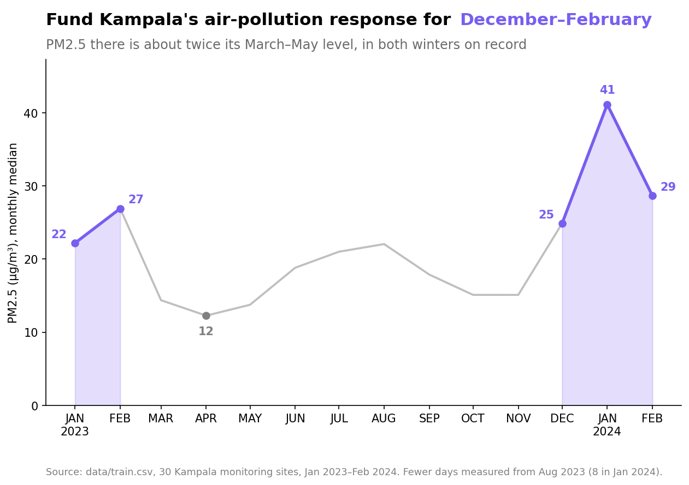

# Module 8 — Data Visualization

The chart is built in `notebooks/session3/08_data_visualization.ipynb` from `data/train.csv`: the monthly median PM2.5 of Kampala's 30 monitoring sites, January 2023 to February 2024. The other two charts are `module_8_BG1.png` and `module_8_BG2.png`.

## Question 1

**Question:** Who are you in this scenario — what role or organization are you speaking from?

**Answer:** I am an air-quality analyst for a monitoring network operating sensors across Kampala. My job is to turn the network’s readings into recommendations the city can act on; I do not decide or spend the budget myself.

## Question 2

**Question:** Who exactly is your audience, and what are you asking them to fund or decide?

**Answer:** My audience is the head of public health at the Kampala Capital City Authority, the person who decides when the city’s air-pollution response budget is spent: public health alerts, enforcement against open waste burning, and dust control on roads and construction sites. I am asking them to concentrate that budget on December–February, instead of spreading it evenly across the year.

## Question 3

**Question:** State your Big Idea as a single, complete sentence.

**Answer:** Fund Kampala’s air-pollution response for December–February, when PM2.5 is about twice its March–May level, in both winters on record.

The number behind “about twice”: the December–February monthly medians average **28.8 µg/m³**, against **13.5 µg/m³** for March–May 2023, a ratio of 2.1. The ratio holds in each winter separately: 1.8 for January–February 2023 and 2.3 for December 2023–February 2024.

## Question 4

**Question:** Justify Steps 2 to 4 for this chart: why that chart type over the alternatives, what you removed at Step 3, and what you focused on at Step 4.

**Answer:**

**Step 2 — chart type.** The message is about *when* pollution is high, so the chart needs time on the x-axis and a shape the eye can follow: a single line over 14 months. I chose Kampala alone because it is the only city with more than a year of data, so it is the only one where the December–February peak can be seen twice. Nairobi, Lagos and Bujumbura cover three to nine months each; adding them would split attention and suggest a comparison between cities that is not my message. Lagos, with the highest levels, would draw the eye away from the seasonal pattern. A bar chart of 14 months would have made the rise and fall harder to read than a continuous line. Two choices happened before plotting: each month is summarised by its **median** reading, because a few sensor spikes pull the mean up (December 2023: mean 29.9, median 24.9), and the vertical axis starts at zero, so “twice” looks like twice.

**Step 3 — what I removed.** The top and right spines, and the legend: there is only one series, and the title names the highlighted months in their own color. I wrote the year once, under each January, instead of on every tick, and replaced the dates with three-letter month names. Values are rounded to whole numbers, and only the six points the message needs carry a label, not all 14 months. The y-axis label stays, because the unit (µg/m³) and the aggregation (monthly median) are needed to read the numbers correctly.

**Step 4 — what I focused on.** The year is drawn in grey as context, and only the December–February months are vivid, in IBM purple (`#785EF0`). That color is checked for color-vision deficiencies and is not used in the other two charts, where blue, orange and pink already mean capacity, demand and the gap. The area under those months is filled down to zero, so each winter reads as a block of pollution rather than a thin line. The April low, 12, is labelled in grey so the reader can see the comparison behind “twice” without reading the axis. The word “December–February” in the title takes the same purple as the highlighted months, and a grey subtitle states the stake. Under the “close your eyes” test, the first things I see are the two purple blocks at both ends of the year.

**Limits.** Two winters are a small basis for a recurring pattern, and January 2024, the highest month, rests on only 8 days of measurements; the footnote of the chart says so. The data shows *when* PM2.5 is high, not *why*: a link to the dry season, or to burning and dust, is a plausible interpretation that this dataset does not test. Nothing here measures whether the proposed measures would reduce exposure either; the chart supports the timing of the budget, not its content.
